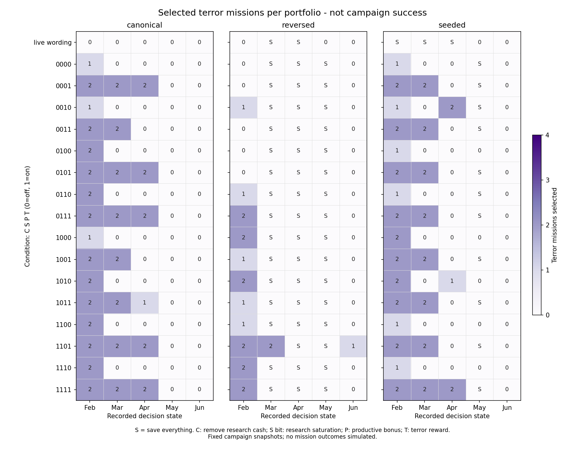

# Full conquest incentive factorial: payoff clarity helps; order sensitivity persists

Completed 255 offline portfolios: 16 binary reward combinations x five recorded monthly states x three PLAN option orders, plus 15 live-wording controls. All 255 are legal and within strict input limits (maximum 475/512 tokens). Original saves and the live model/planner/experiment scripts were hash-checked unchanged. No mission was executed, native reward changed, model trained, API called, commit made or push performed. The live policy remains v9.

## The strongest finding: existing rewards described explicitly eliminate research in this sample

The live-wording controls choose 12 research operations across 15 portfolios. The matched explicit-current condition (0000, every reward switch off) chooses zero. All 240 factorial portfolios also choose zero research, regardless of whether research retains its cash payout or unlimited intelligence gains. Therefore this sample does not support the claim that removing research cash or adding saturation is necessary to escape research-heavy choices. The explicit contract adds existing conditional outcomes, the harvest-to-base prerequisite and the same short payout-limit sentence; this is an information/description intervention, not merely a label-order change. Its separate components were not isolated.

## Main effects of the four reward switches

Paired on-minus-off differences per portfolio, averaged equally over the other three switches, five fixed states and three orders. These are descriptive finite contrasts, not independent trials, p-values, expected utility or game-quality scores.

| Switch enabled | Terror missions | Infiltrations | Resources spent now | Complete deferral |
|---|---:|---:|---:|---:|
| Remove research cash | +0.125 | +0.058 | +0.85 | -3.33 percentage points |
| Cap research intelligence gains | +0.092 | +0.125 | +0.75 | -1.67 percentage points |
| Raise productive payouts | +0.058 | -0.008 | -0.13 | +1.67 percentage points |
| Reward successful terror | +0.442 | -0.242 | -0.75 | +3.33 percentage points |

The terror reward has the largest average effect on terror choice (+0.442), but it also reduces infiltration and search selection (search -0.333) and slightly increases complete deferral. Its effect is phase-dependent: +0.333 terror missions in February, +1.417 in March, +0.417 in April, zero in May and +0.042 in June. These are separate recorded states, not a simulated campaign that changed because of earlier choices. Raising harvest/abduction rewards has little positive effect on their combined selection in this sample (harvest +0.008, abduction -0.092). Do not interpret the model as a reliable numerical reward optimizer.

## Interactions

Each value is a paired difference of differences, averaged over the remaining switches, months and orders. All two-, three- and four-way contrasts are retained in results.json. The largest two-way interaction on terror selection is research saturation x terror reward (+0.283). Productive bonus x terror reward is -0.117. These interactions include the classifier response to the changed text; they do not identify a learned strategic utility function.

| Pair | Terror interaction | Infiltration interaction | Spend interaction |
|---|---:|---:|---:|
| Remove research cash x Cap research intelligence gains | +0.050 | -0.017 | +0.03 |
| Remove research cash x Raise productive payouts | -0.017 | +0.050 | +0.20 |
| Remove research cash x Reward successful terror | +0.017 | -0.017 | -0.10 |
| Cap research intelligence gains x Raise productive payouts | -0.017 | -0.017 | -0.33 |
| Cap research intelligence gains x Reward successful terror | +0.283 | -0.083 | +0.50 |
| Raise productive payouts x Reward successful terror | -0.117 | +0.117 | +0.27 |

## Presentation remains the larger execution problem

Across the 80 factorial portfolios per order:

| PLAN order | Complete deferral | Mean operations | Mean spend |
|---|---:|---:|---:|
| canonical | 0.0% | 3.60 | 11.50 |
| reversed | 58.8% | 0.95 | 4.01 |
| seeded | 13.8% | 2.83 | 9.36 |

Exact full-portfolio agreement across all three orders occurs in only 3 of 80 condition-by-month groups; mission-mix agreement occurs in 5 of 80. Different sensible portfolios are not automatically failures, but operation versus complete deferral is a material behavioral difference. Reversal changes all option positions, not only SAVE, so it does not isolate a single-position cause. The one fixed seeded order is not a broad random-permutation sample. The target-option order is unchanged throughout.

## Full matrix

Numbers are terror mission counts; S marks complete deferral. Neither darker color nor a more varied portfolio means better conquest.

## June: a different concentration of choices, not proven balanced conquest

Canonical June with live wording chooses four research missions. Explicit-current and all-switches-on both choose four harvests: Australasia, Southern Africa, Central Asia and South America. That could be useful preparation for logistics two, but no subsequent harvest outcomes or transition into base construction were simulated.

All-switches-on reversed June chooses a search and three infiltrations; seeded June chooses two abductions and then defers. Only one of the 48 June factorial portfolios includes any terror, and none of the 48 May portfolios do. The lone June terror is condition 1101 in reversed order. It would be cherry-picking to promote that condition simply for restoring a late terror mission. No condition is designated a winner.

## Every condition

Bits C,S,P,T mean remove research cash; cap research intelligence gains; raise harvest/abduction payout; reward successful terror. Each row covers the same 15 fixed-state/order portfolios. Counts and spend are descriptive, not quality rankings.

| Condition | Research | Harvest | Abduction | Terror | Infiltration | Search | Defer all | Spend |
|---|---:|---:|---:|---:|---:|---:|---:|---:|
| live_wording | 12 | 5 | 12 | 0 | 0 | 5 | 5 | 85 |
| 0000 | 0 | 21 | 5 | 2 | 3 | 6 | 4 | 116 |
| 0001 | 0 | 18 | 5 | 10 | 0 | 0 | 4 | 109 |
| 0010 | 0 | 21 | 4 | 5 | 2 | 4 | 4 | 115 |
| 0011 | 0 | 21 | 3 | 8 | 1 | 0 | 4 | 110 |
| 0100 | 0 | 19 | 6 | 3 | 7 | 5 | 3 | 139 |
| 0101 | 0 | 18 | 5 | 10 | 1 | 0 | 4 | 115 |
| 0110 | 0 | 21 | 2 | 4 | 5 | 4 | 4 | 123 |
| 0111 | 0 | 17 | 4 | 12 | 1 | 0 | 4 | 117 |
| 1000 | 0 | 21 | 5 | 5 | 5 | 5 | 3 | 138 |
| 1001 | 0 | 20 | 5 | 9 | 0 | 0 | 4 | 111 |
| 1010 | 0 | 20 | 6 | 7 | 4 | 3 | 3 | 136 |
| 1011 | 0 | 19 | 4 | 10 | 1 | 0 | 4 | 115 |
| 1100 | 0 | 19 | 4 | 4 | 6 | 7 | 3 | 135 |
| 1101 | 0 | 16 | 6 | 15 | 2 | 1 | 3 | 140 |
| 1110 | 0 | 18 | 4 | 5 | 6 | 8 | 3 | 138 |
| 1111 | 0 | 16 | 3 | 14 | 3 | 1 | 4 | 133 |

## What this does and does not establish

This is a full 2^4 factorial of four selected binary reward-description changes. It is not a full search over reward amounts or the whole game economy. The same career-trained checkpoint is fixed throughout. Describing a hypothetical payout is not training on it. There are no supplied success probabilities or expected mission values, and no alternate February reward is propagated into March-June. Country influence outside the base mechanic and terror-success admission would require native implementation before playtesting.

All five actual states lack logistics two, so direct base construction is unavailable in every arm. Funded base assault also remains unavailable. The study cannot demonstrate a full conquest policy over those missing actions. Native mission types also differ in craft schedules and site pressure; operation counts alone cannot establish gameplay difficulty.

## Recommended next experiment

Keep the hypothetical reward changes offline. First compare the current chooser against permutation-aggregated PLAN scores using the unchanged explicit native reward contract, with held-out order permutations. That tests whether the execution/deferral split can be reduced without forcing a mission quota or selecting a conveniently favorable order. Preserve the separate target stage and assess its interference-risk choices.

Only then choose a reward candidate for native implementation and actual delivered-outcome playtesting. The payoff descriptions and harvest-to-base path are worth retaining as a candidate; the data do not justify adopting the entire reward bundle as a balanced strategy.

## Reproduction and validation

- Protocol and selected reward levels: [PROTOCOL.md](PROTOCOL.md).
- Runner: scripts/test-conquest-factorial.py; analyzer: scripts/analyze-conquest-factorial.py.
- 89 Python tests passed, including factor isolation, endpoint equivalence with the earlier probe, order-preserving cache keys and a known synthetic factorial interaction.
- Installed inference runtime: torch 2.10.0+cpu, no CUDA. Hardware is AMD RX 9060 XT, but no GPU runtime was installed or changed.
- 637 new model inferences, 4 uncached automatic single-eligible-action decisions, and 700 exact ordered-packet decision reuses. Runtime newCalls=641 includes those four automatic choices; they are not model inference. Cache reuses include earlier recorded decisions and reuse within this run, not independent samples.
- Total measured portfolio evaluation time: about 24 CPU minutes, excluding model loading. No API costs.
- Raw states, questions, probabilities, cache origins, model identity and source hashes: build/local/conquest-factorial-v1/<decision-month>/.
- Full finite contrasts (including by-month and by-order), condition totals and all 255 compact portfolios: [results.json](results.json).
- Exportable matrix: [SVG](terror-matrix.svg) and [PNG](terror-matrix.png).
